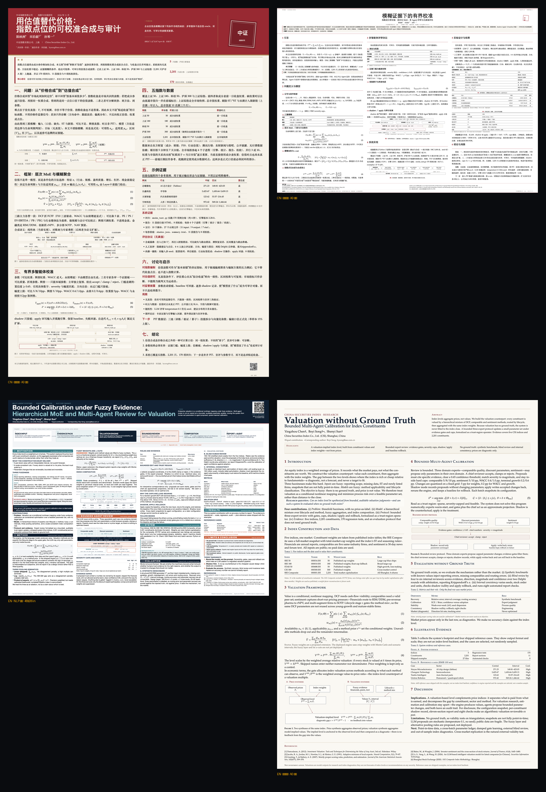

# 四张学术海报（2026-11-28）

同一项工作的四个学术版本，面向不同读者与评审文化。所有事实、作者、公式与案例以 [CONTENT.md](CONTENT.md) 为唯一来源。

| 文件 | 语言 | 尺寸 | 风格 | 读者 | 叙事重点 |
|---|---|---|---|---|---|
| [cn-finance.tex](cn-finance.tex) / [pdf](cn-finance.pdf) | 中文 | A0 竖版 841×1189mm | 上交所红/米色、宋体、ledger 表格、2 栏 | 国内证券/金融刊物、指数业务 | 为什么用估值合成指数、五指数落地、案例与启示 |
| [cn-core.tex](cn-core.tex) / [pdf](cn-core.pdf) | 中文 | A0 横版 1189×841mm | 白底黑字、红色细线、三线表、编号公式、3 栏 | 中文核心期刊/学术会议 | 问题形式化、模型、协议、实验设计、局限 |
| [en-nlp.tex](en-nlp.tex) / [pdf](en-nlp.pdf) | 英文 | 48×36in 横版 1219×914mm | ACL/EMNLP 风：navy/teal/coral、4 栏、彩色 section bar、大图 | NLP 顶会（ACL/EMNLP/NAACL） | 多智能体、证据门控、有界参数编辑、评估与可复现 |
| [en-finance.tex](en-finance.tex) / [pdf](en-finance.pdf) | 英文 | A0 竖版 841×1189mm | AFA/金融期刊风：parchment、Palatino、burgundy/navy、2 栏 | 海外金融期刊/会议 | 经济问题、指数构建、估值框架、案例、讨论 |

预览图在 [`previews/`](previews/)，由 PDF 以 `sips` 渲染。四张总览：



## 作者与单位（四张统一）

- **英文**：Yingzhou Chen†, Boyi Song†,\*, Shenyi Sun†  
  China Securities Index Co., Ltd. (CSI), Shanghai, China  
  † Equal contribution. \* Corresponding author: Boyi Song, bysong@sse.com.cn
- **中文**：陈映洲†　宋泊毅†,\*　孙棽一†  
  中证指数有限公司，上海  
  † 共同第一作者；\* 通信作者：宋泊毅，bysong@sse.com.cn

## 视觉体系（上交所风格）

- 主色：lacquer red `#A6192E`、vermilion `#E60012`（极少量）、ink `#141414`、cream `#F7F2E8`、gold `#B08A4A`、hairline `#D8D0C2`。
- 中文：Songti SC 正文、PingFang SC 标题；英文金融：Palatino；英文 NLP：Helvetica Neue。
- 四张都用“细红线 + 印章 + ledger 表格”的上交所机构感；NLP 版把红降为点缀，主色改为 navy/teal，以符合 ACL/EMNLP 审美。
- 不使用上交所官方 Logo；印章为抽象“中证”标识。

## 编译

```bash
bash docs/posters/build.sh
```

或单张：

```bash
cd docs/posters
xelatex -interaction=nonstopmode cn-finance.tex
xelatex -interaction=nonstopmode cn-finance.tex
sips -s format png cn-finance.pdf --out previews/cn-finance.png
```

要求：每张 **恰好 1 页**、0 Overfull、0 Missing character。编译后清理 `.aux/.log/.nav/.out/.snm/.toc`。

## 内容边界

- 不以“贴近指数收盘”为优化目标；市场价格只作诊断。
- 不写“跑赢指数/预测点位/准确率 X%/覆盖率 100%”等未验证结论。
- 参考案例是技能包示例（4 个），**不是指数级回测**；样本为示例、非随机抽样。
- 模糊 α-cut、对数池/专家乘积、自迭代门控学习为论文扩展，海报上必须标“proposed / not deployed”。

## 旧版

第一版单张 A0 海报（`02-poster.tex`）已归档到 [`../archive/poster-v0/`](../archive/poster-v0/)，不再维护。
